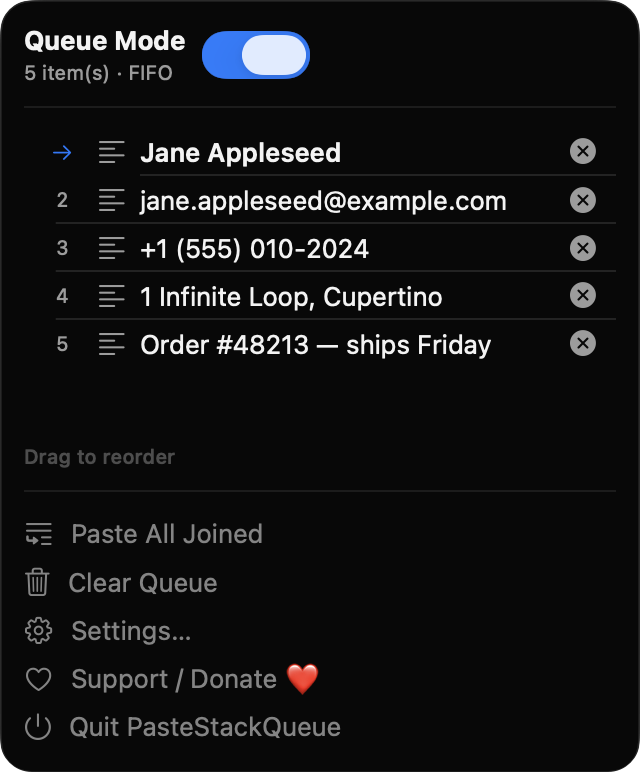
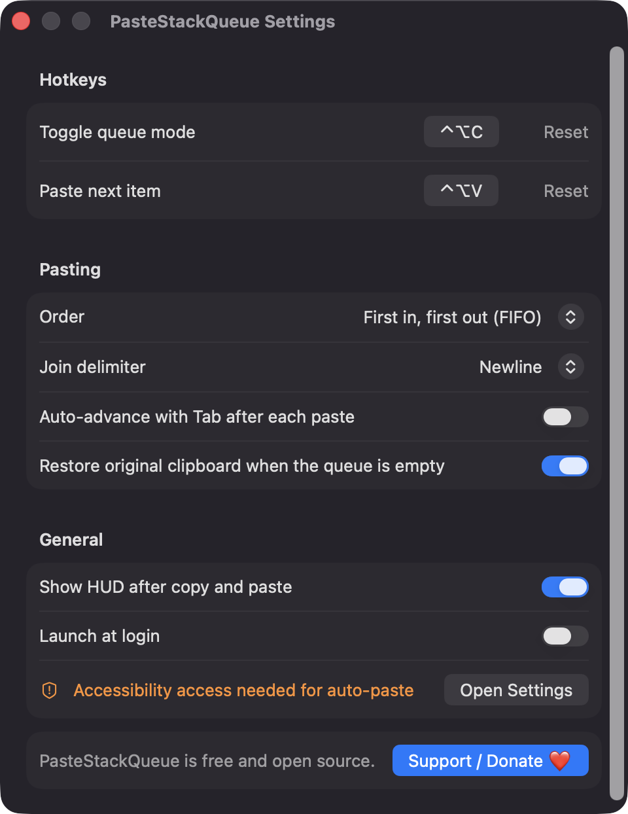
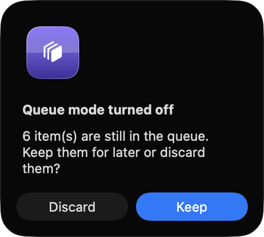

# PasteStackQueue

**🌐 Website:** [turhe123.github.io/paste-stack-queue](https://turhe123.github.io/paste-stack-queue/)

**Copy many things in a row, then paste them back one by one in order with a single hotkey.**

> 🆓 A free, open-source **Copy 'Em alternative** for macOS 14+. Native Swift, no accounts, no subscriptions, MIT licensed.


## Why

PasteStackQueue is a free, open-source, 100% native, backend-free alternative to paid utilities in the *Clipboard* category. It was inspired by the multi-item copy-and-paste workflow of Copy 'Em ($14.99 one-time), and isolates just that one job into a tiny menu bar app. There are no accounts, no servers and no network access: your clipboard never leaves your Mac.

## Features

- **Queue mode** that you switch on and off with a global hotkey (default `⌃⌥C`). While it is on, every copy in any app is appended to an ordered queue.
- **Sequential paste** with a second global hotkey (default `⌃⌥V`): the next item is placed on the pasteboard, pasted into the frontmost app with ⌘V, and removed from the queue.
- **FIFO or LIFO** paste order.
- **Paste All Joined**: paste the whole queue at once, separated by a newline, comma, tab, space or semicolon. Images are excluded from joined pastes.
- **Auto-advance**: optionally send a Tab keypress after each paste so values fill successive form fields.
- **Text, files and images**: plain text, file URLs and images (stored as TIFF) can be queued.
- **Menu bar UI**: the icon is hollow when queue mode is off and shows a count badge when it is on. The menu lists the queued items (first 40 characters), marks the next item with an arrow, and lets you drag to reorder, delete single items, or clear the queue.
- **Floating HUD** that briefly confirms each copy and paste ("Added 3", "Pasted, 2 left"). It can be turned off.
- **Restore clipboard**: optionally restores your original clipboard contents once the queue has been emptied.
- **Safe by default**: ignores concealed, transient and auto-generated pasteboard types (e.g. password managers), never captures its own pasteboard writes, and skips items larger than 1 MB. The queue is capped at 200 items.
- **Crash-safe**: the queue is mirrored to a small JSON file in `~/Library/Application Support/PasteStackQueue/`.
- **Turning queue mode off** asks whether to keep or discard the remaining items.
- **Customisable hotkeys** with a click-to-record control and an inline warning if a shortcut is unavailable.
- **Launch at login** via `SMAppService`.

## Screenshots

<p align="center"></p>

<p align="center"><em>The menu bar panel with Queue Mode on, listing five copied items in order with an arrow marking the next one to paste.</em></p>

<p align="center"></p>

<p align="center"><em>Settings for the global hotkeys, FIFO/LIFO paste order, join delimiter, auto-advance with Tab, clipboard restore, HUD and launch at login.</em></p>

<p align="center"></p>

<p align="center"><em>When you turn queue mode off, the app asks whether to keep the remaining items for later or discard them.</em></p>

## Install

1. Download `PasteStackQueue-macOS.zip` from the [latest release](https://github.com/turhe123/paste-stack-queue/releases/latest).
2. Unzip it and move `PasteStackQueue.app` to `/Applications`.
3. Because the app is open source and not notarized, clear the quarantine attribute:

   ```bash
   xattr -cr /Applications/PasteStackQueue.app
   ```

4. Right-click the app and choose **Open** the first time you launch it.

## Build from source

Requires macOS 14+ and Xcode with Swift 5.9+.

```bash
brew install xcodegen
xcodegen generate
xcodebuild -project PasteStackQueue.xcodeproj -scheme PasteStackQueue -configuration Release -derivedDataPath ./build build
```

The app is produced at `build/Build/Products/Release/PasteStackQueue.app`.

## Permissions

- **Accessibility** (the only permission the app requests): needed to send the ⌘V keystroke (and the optional Tab) to the frontmost app. The app asks the first time you paste. Without it, the paste hotkey still puts the next item on the clipboard and you press ⌘V yourself. Enable it in System Settings › Privacy & Security › Accessibility.

PasteStackQueue does not request Screen Recording, Microphone, Camera or network access, and the source contains no code that uses them.

## Built with AI

PasteStackQueue was written by [Claude Code](https://claude.com/claude-code) inside an automated pipeline, from a plain-English spec. No code, binaries or assets from any commercial app were used; it is a clean-room reimplementation of a feature set, not a copy.

What that means in practice:

- The full source is in this repo under the MIT license. Read it before you run it.
- No network calls, no analytics, no third-party dependencies. Only Apple frameworks.
- Ad-hoc signed and not notarized, which is why Gatekeeper warns on first launch.
- It has had less human review than a hand-written app. Bug reports and pull requests are welcome.

## Support ❤️

PasteStackQueue is free and always will be. If it saves you time, you can support its development:

[%20Davidai%20%E2%9D%A4%EF%B8%8F-ff5e5b?logo=ko-fi&logoColor=white)](https://ko-fi.com/leodavidai)

[Support Or (Leo) Davidai ❤️](https://ko-fi.com/leodavidai)

## More free Mac apps

PasteStackQueue is one of a growing collection of [free, open-source Mac utilities](https://github.com/turhe123/mac-apps) built the same way: native Swift, no accounts, no telemetry. Browse the full gallery at [turhe123.github.io/mac-apps](https://turhe123.github.io/mac-apps/).

Prefer something that runs in the browser? The same pipeline builds [free, private web tools](https://turhe123.github.io/web-tools/): PDF, image, developer, data and audio tools, nothing uploaded.

## License

MIT © Or Davidai Bachar
